# Gestor de Equipe

Sistema web para gestão de colaboradores, contratos de estágio e férias, criado para substituir o controle feito em planilhas por uma interface visual, centralizada e com alertas de prazos.

> **Projeto de portfólio.** Todos os dados exibidos são fictícios.

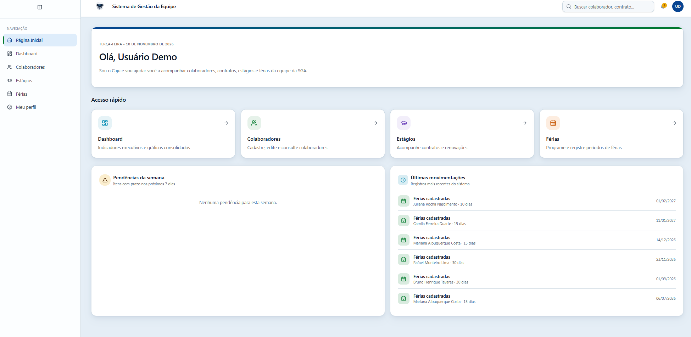

## O problema

Em uma área administrativa de órgão público, o controle de contratos e férias era feito em planilhas eletrônicas, o que gerava:

- dificuldade de ter uma visão consolidada da equipe;
- risco de perder prazos de vencimento de contratos;
- consultas manuais e demoradas;
- ausência de indicadores e alertas automáticos;
- baixa rastreabilidade das informações.

## A solução

Uma aplicação web que centraliza o cadastro e o acompanhamento de colaboradores, estágios e férias, com dashboard executivo e alertas visuais para contratos e férias próximos do vencimento ou do início.

O sistema foi pensado para **conviver com automações já existentes** (geração de documentos e envio de processos), servindo como interface central de consulta e acompanhamento, sem substituí-las. Uma automação em **n8n**, executada em **Docker**, cria os processos de renovação automaticamente no Supabase, e o sistema reflete a atualização sem cadastro manual.

## Funcionalidades

### Visão geral
- **Página inicial:** saudação personalizada, atalhos de acesso rápido, pendências da semana e últimas movimentações do sistema.
- **Dashboard executivo:** filtros por período, vínculo e status; indicadores de colaboradores ativos, estagiários ativos, férias programadas e contratos vencendo em 30 dias; alertas operacionais; listas de estágios próximos do vencimento e de próximas férias; exportação em CSV.

### Colaboradores
- Lista com busca por nome ou CPF e filtros por tipo de vínculo e status.
- Cadastro, edição e visualização de cada colaborador.
- Tela de detalhes com dados cadastrais, vínculos de estágio e histórico de férias.
- Colaboradores desligados permanecem na lista, com destaque visual.

### Módulo de Estágios
Organizado em quatro abas:

- **Gestão de Estágios:** indicadores (ativos, vencendo em 30 dias, vencidos e desligados) e tabela com tipo (público ou privado), instituição, início, renovação, término, dias restantes calculados automaticamente e status do contrato. As renovações recebem selos como "Próxima" e "Futura".
- **Instituições:** instituições de ensino com o número de estagiários vinculados e um painel lateral com a lista de estagiários de cada uma.
- **Processos:** histórico administrativo por estagiário (renovações e outros), com número do processo, data e observações, em linhas expansíveis.
- **Desligamentos:** registros de desligamento com número do processo, data, motivo e observações, também com histórico expansível.

### Módulo de Férias
Organizado em três abas:

- **Gestão de Férias:** períodos por colaborador, com controle de período aquisitivo (1º período, 2º período ou período único), datas de gozo, quantidade de dias, número do processo e status (planejada ou realizada).
- **Histórico:** consulta dos períodos de férias já registrados.
- **Calendário:** visualização mensal dos períodos, com filtros por vínculo e status e legenda por tipo de vínculo.

### Experiência de uso
- Menu lateral recolhível, busca global e breadcrumbs.
- Badges coloridos para vínculo, status e prazos.
- Login com acesso restrito a usuários autorizados.

## Regras de negócio

- Cada colaborador tem um cadastro único.
- Apenas colaboradores com vínculo "Estágio" têm registros no módulo de estágios.
- Um colaborador pode ter vários períodos de férias, identificados por período aquisitivo.
- Colaboradores desligados permanecem no histórico e não entram na contagem de ativos.
- Contratos e férias próximos são destacados no dashboard e na página inicial.

## Arquitetura da solução

A aplicação utiliza o Supabase como camada central de dados e autenticação. O Gestor de Equipe consulta e atualiza essas informações por meio da interface, enquanto o n8n executa automaticamente o fluxo de renovação de estágios.

```text
                    ┌───────────────┐
                    │     n8n       │
                    │    Docker     │
                    └───────┬───────┘
                            │
                     Consulta e atualiza
                            │
                            ▼
┌───────────────┐     ┌───────────────┐
│ Gestor de     │────▶│   Supabase    │
│ Equipe        │◀────│ Auth + Banco  │
│ React + TS    │     │  PostgreSQL   │
└───────────────┘     └───────────────┘
        ▲
        │
     Usuários
```

## Tecnologias

| Camada | Tecnologia |
|---|---|
| Frontend | React, TypeScript, Vite |
| Estilização | Tailwind CSS, shadcn/ui |
| Backend e autenticação | Supabase (Auth + PostgreSQL) |
| Construção da interface | Lovable |
| Automação | n8n, executado em Docker |

## Design

- Interface moderna e limpa, com cards de bordas arredondadas e sombras suaves.
- Paleta com azul e verde como cores principais, amarelo para alertas e vermelho para urgências.
- Status com cores consistentes entre as telas.
- Tabelas com cabeçalho destacado, busca e ações por linha.
- Responsivo, com foco em desktop e adaptação para tablet.

## Telas

### Dashboard

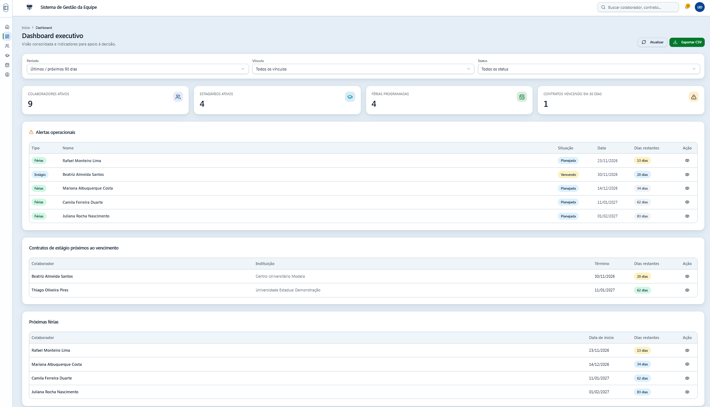

### Colaboradores

| Lista | Detalhes |
|---|---|
| 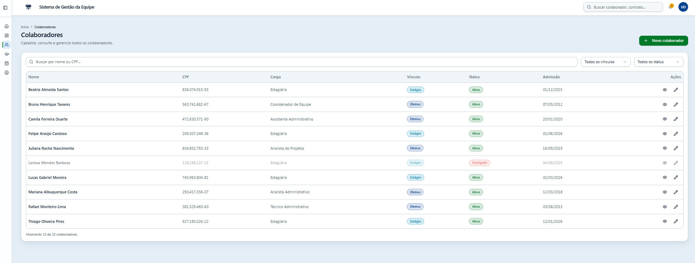 | 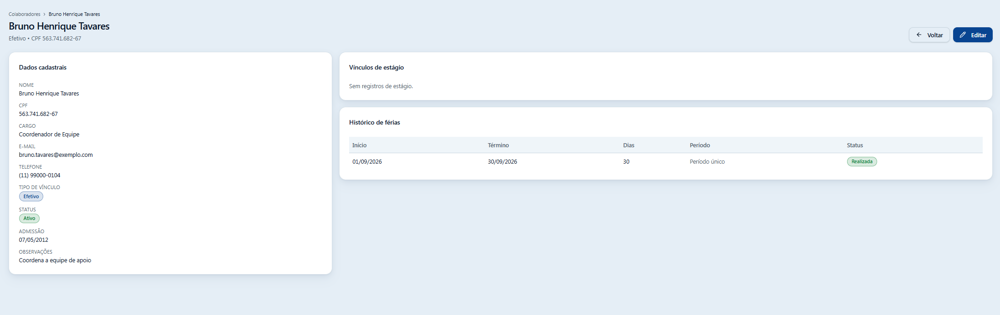 |

### Estágios

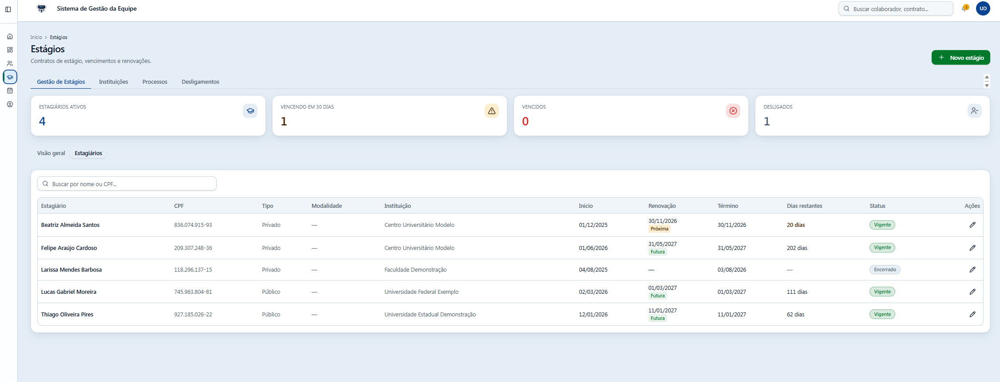

| Instituições | Processos |
|---|---|
| 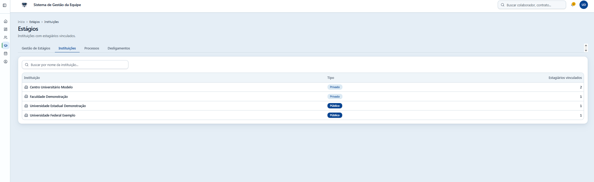 | 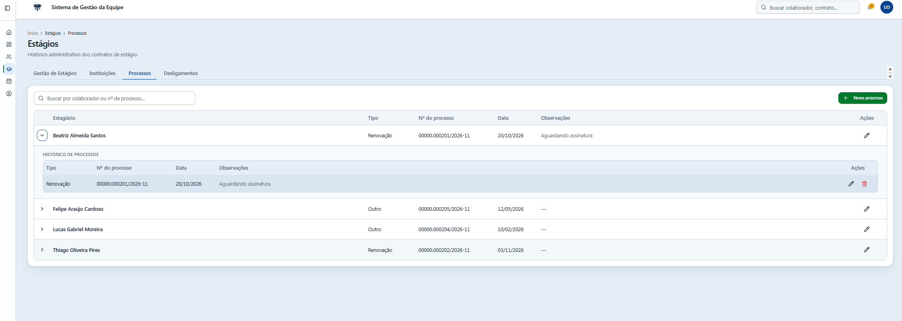 |

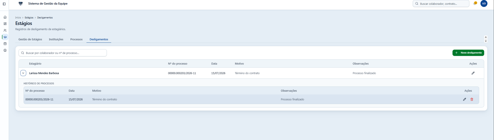

### Férias

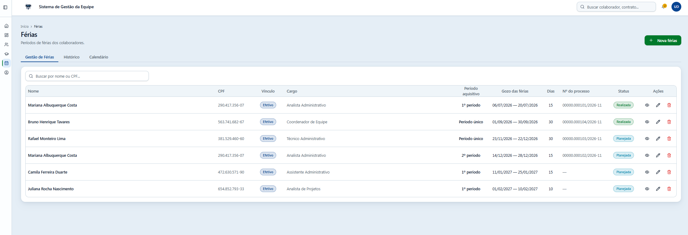

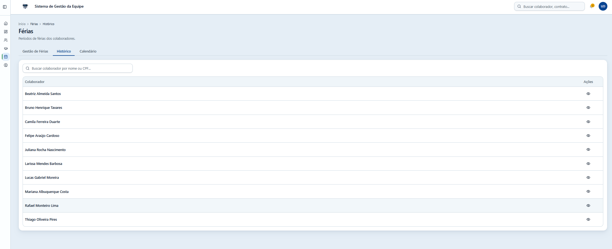

<!-- Se quiser incluir o calendário, suba ferias-calendario.png e remova os marcadores desta linha:
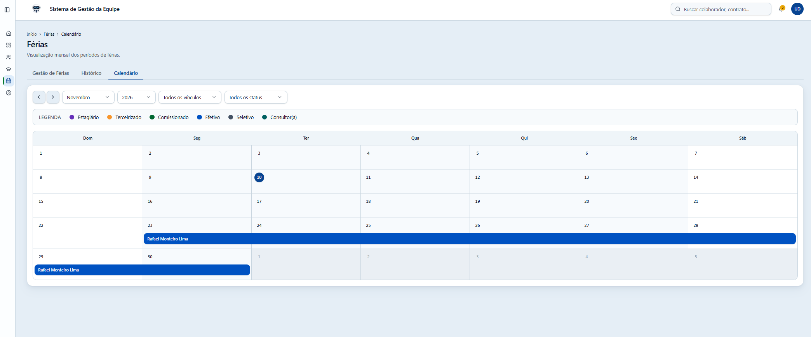
-->

### Login

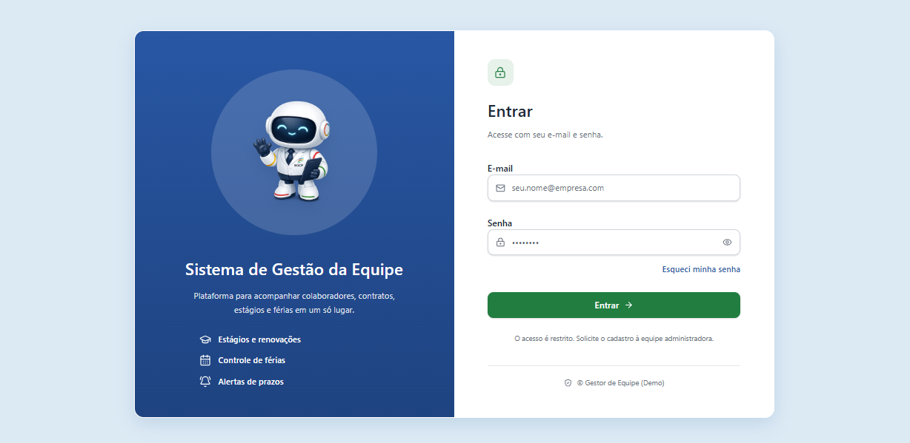

## Automação com n8n

Um fluxo automatizado no **n8n consulta e atualiza os dados no Supabase, e o Gestor de Equipe reflete essas atualizações na interface**. Ele roda todos os dias às 9h e executa as etapas abaixo:

1. Lê os registros da tabela de processos no Supabase.
2. Verifica se a data de aviso de algum estágio é a data de hoje.
3. Para cada renovação encontrada, gera o aviso, o processo e o memorando.
4. Registra o novo processo no Supabase, com status "pendente" e o contador de renovações atualizado.
5. O sistema mostra o processo novo na aba **Processos**, sem cadastro manual.

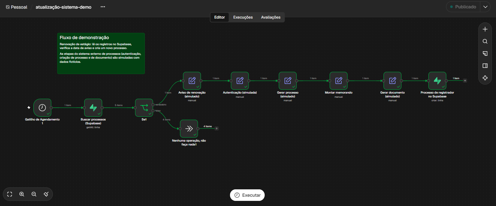

> **Ambiente de demonstração.** Na versão original, as etapas de autenticação, criação de processo e criação de documento acontecem em um sistema externo de processos. Neste repositório elas são **simuladas** com dados fictícios, e só a leitura e a gravação no Supabase são reais.

### Executar o n8n com Docker

Os arquivos estão na pasta [`n8n/`](n8n/). Com o Docker instalado:

```bash
cd n8n
docker compose up -d
```

1. Acesse `http://localhost:5678` e crie a conta de proprietário.
2. Importe o fluxo `atualizacao-sistema-demo.json` (menu **⋯ > Import from file**).
3. Crie a credencial do Supabase com a URL do projeto e a chave `service_role`, e selecione-a nos dois nós Supabase.
4. Clique em **Execute** para testar, ou em **Publish** para o fluxo rodar todo dia às 9h.

O container usa `restart: unless-stopped`, então o n8n volta sozinho quando o Docker reinicia, e os fluxos ficam guardados em um volume. A chave `service_role` fica só nas credenciais do n8n e nunca vai para o repositório.

## Como executar localmente

Pré-requisitos: Node.js e npm.

```bash
# 1. Clone o repositório
git clone https://github.com/sarahreivan/gestor-de-equipe-demo.git

# 2. Entre na pasta
cd gestor-de-equipe-demo

# 3. Instale as dependências
npm install

# 4. Inicie o servidor de desenvolvimento
npm run dev
```

Se for usar seu próprio projeto Supabase, crie um arquivo `.env` com a URL e a chave pública (anon):

```env
VITE_SUPABASE_URL=sua-url
VITE_SUPABASE_PUBLISHABLE_KEY=sua-chave-anon
```

## Próximos passos

- Conectar as etapas simuladas do fluxo a um sistema de processos real.
- Avisos de renovação e de férias por e-mail ou calendário, disparados pelo n8n.
- Perfis de acesso, com permissões diferentes por tipo de usuário.
- Exportação de relatórios em Excel e PDF, além do CSV que já existe.
- Linha do tempo unificada por colaborador.
- Auditoria de alterações.

## Autora

**Sarah Reivan**
[LinkedIn](https://www.linkedin.com/in/sarahreivan) · [GitHub](https://github.com/sarahreivan)
